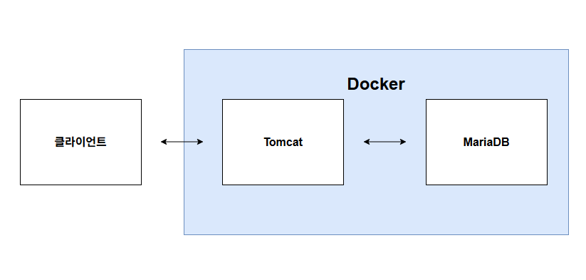
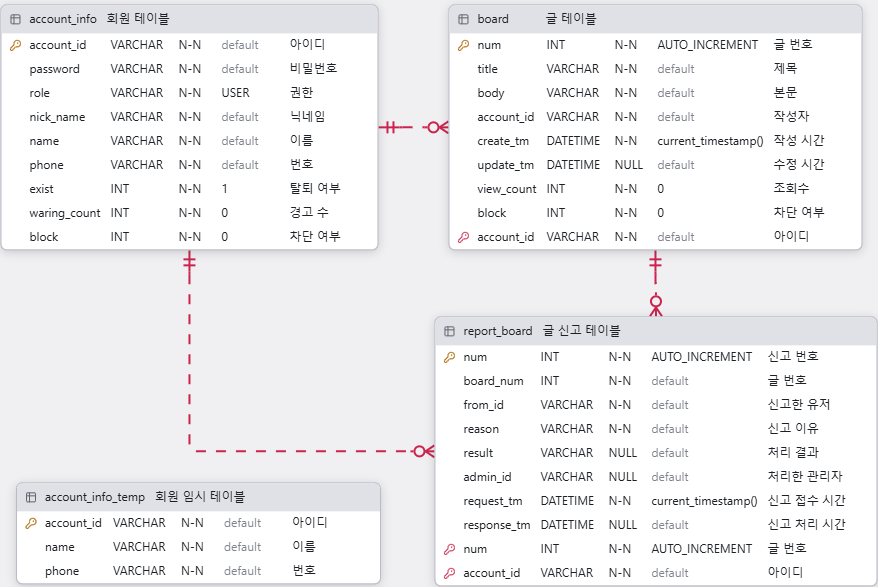

# 소개
JSP와 Spring Boot로 구현한 게시판 프로젝트입니다.

사용 기술 : Java, Spring Boot, Jsp, Jpa, MariaDB

## 프로젝트 구조
```
src/main/java/com/example/board/
├── config/       # Security 및 각종 설정
├── controller/   # 컨트롤러
├── dto/          # 요청 / 응답 / 검색조건 DTO
├── entity/       # JPA 엔티티
├── repository/   # 레포지토리, Specification
└── service/      # 서비스

src/main/webapp/
├── resources/      # CSS, JS
└── WEB-INF/views/  # JSP
```

## 기능
- **회원**
  - 회원가입, 로그인, 로그아웃, 내 정보 수정
- **게시판**
  - 게시글 목록, 상세, 작성, 수정, 삭제
- **신고**
  - 로그인 회원만 게시글 신고
- **관리자**
  - 신고된 게시글 관리
  - 회원 차단 및 해제, 권한 변경
  - 캐시 스케줄러 관리
- **보안**
  - Spring Security 세션 기반 인증
  - 비밀번호는 BCrypt로 암호화
  - 이름/전화번호는 AES로 암호화
  - Spring Security로 관리자 페이지 접근 관리

## URL 구조
```
/board/** : 글 관련 URL

/account/** : 회원 관련 URL

/admin/** : 관리자 관련 URL
```

## 권한 분류
| 권한          | 설명                           |
|---------------|------------------------------|
| `USER`        | 일반 회원                        |
| `LOWER_ADMIN` | 신고 글 관리, 스케줄러 관리             |
| `UPPER_ADMIN` | LOWER_ADMIN 포함, 회원 관리, 권한 변경 |

## 시스템 아키텍처


## 테이블
